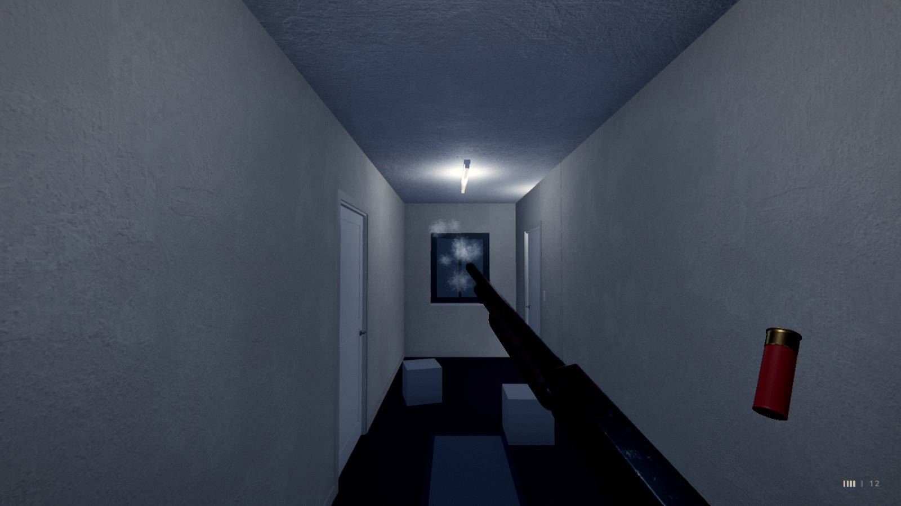
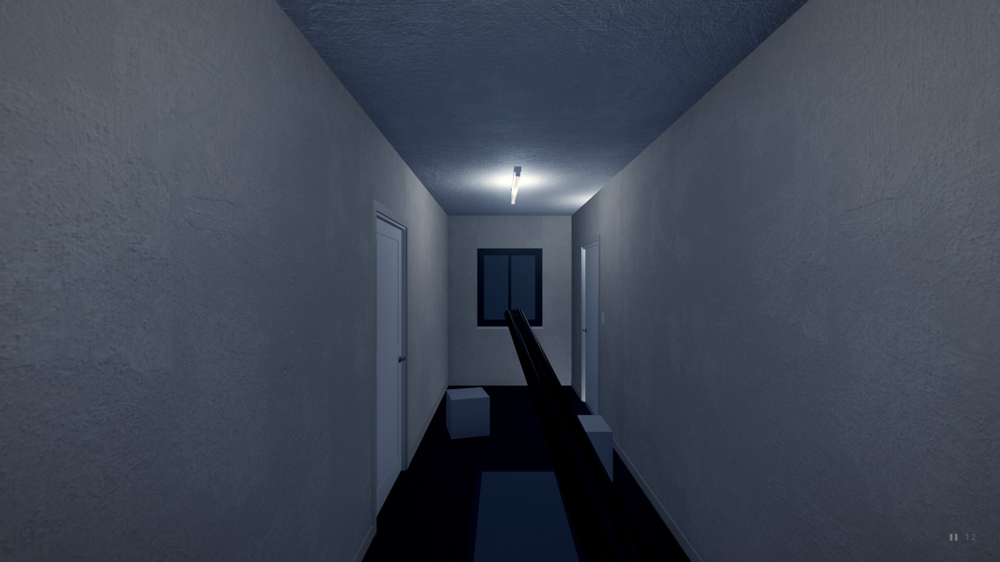
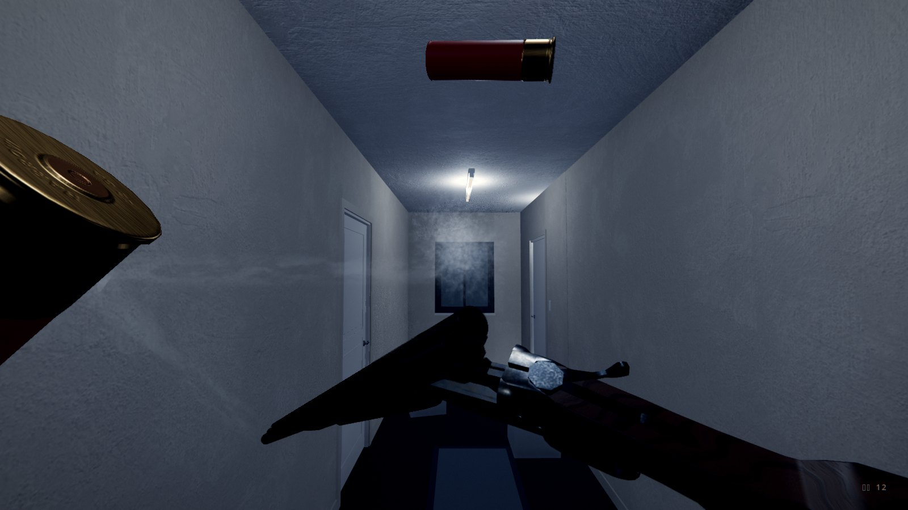
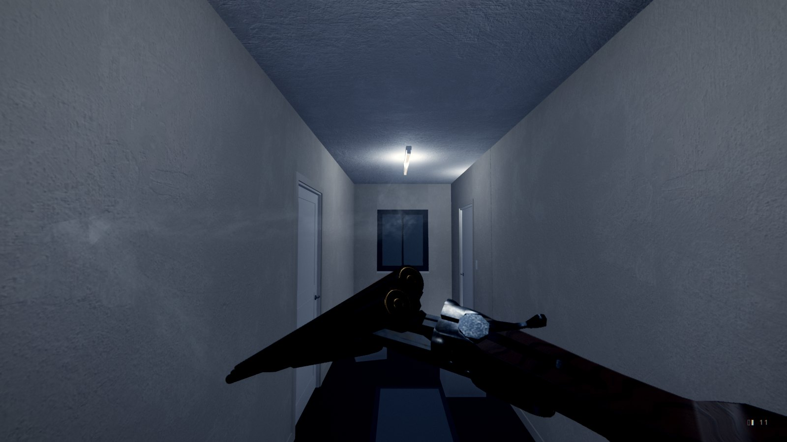
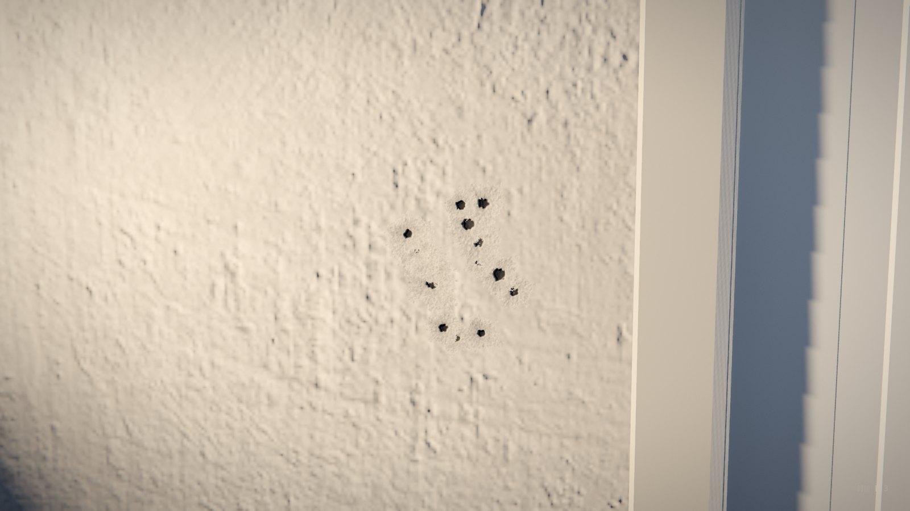

# HorrorStudio Weapons: a shotgun in first person for any Godot 4.7 game

One add-on (`addons/horrorstudio_weapons/`, GDScript with its models and sounds, nothing to build): **HSShotgun**, a
pump-action 12-gauge held in first person, **HSDoubleBarrel**, the v2: a side-by-side that breaks open (the user's own
model), and **HSWeaponPickup**, a gun or a box of shells lying in a room. Made for horror first: one heavy, slow gun,
every shell counted and loaded by hand, and no hands on it (the user's, DECISIONS 2026-11-09). A game made by hand gets
it with `tools/godot_byhand.py`.

Under them, **a muzzle system for any gun** (DECISIONS 2026-11-09, latest): **HSMuzzle**, a gun's muzzle, plays an
**HSMuzzleFlash** (its wings each a run of slightly elongated spheres that intersect, their fronts culled, a noise
mapped triplanar onto each and burnt by the view's normal dotted with the surface's: the user's way), its light,
sparks, the smoke thrown out and **the smoke it trails** wherever the gun goes; **HSShellType**, a kind of shell (its
pellets, its flash, what it does where it lands, its models: the plugin's buckshot and explosive, more by duplicating
one); **HSImpact**, what a hit does (a crater whose PBR maps make pieces look missing, tinted by what was hit, its
dust and chips; the explosive's blast), played by **HSImpacts**.

 
 
 
 

 
 
 

The guide for the user, with these pictures: `guides/weapons/index.html`.

| Piece | File | Use |
|---|---|---|
| **The shotgun** | `shotgun.gd` (`HSShotgun`, a Node3D) | put one under the player's camera. Held low on the right and pointing in, its muzzle just under the middle of the view (its barrel's line meets the middle `aim_at_m` 1.1 m ahead, as the user's reference); the carried flashlight's beam on the middle `beam_at_m` 12 m ahead; it sways behind the view as it turns, bobs as you walk, breathes, kicks, and never pokes through a wall; held to the eye on the right button. The shells low on the right as marks (the tube's four, the chamber's, filled where there's a shell) and the pocket's count, in the HorrorStudio UI's colours (a shell of another kind in its kind's colour). Every shell has a kind (`kinds`: the plugin's buckshot and explosive when empty): the tube's in order (`tube`), the chamber's (`chamber_kind`), the pocket's (`spare` the kind loaded next's, `load_kind`; the others' in `pocket`); **T** picks the kind R loads. A shot is the chambered shell's: its pellets, its muzzle flash (an HSMuzzle at the `muzzle` socket: `muzzle()`), its impact. `pull()`, `rack()`, `reload()`, `set_aim(on)`, `set_raised(up)`, `give(shells, kind)`, `add_shells(n, kind)`, `set_load_kind(kind)`, `next_kind()`, `shells_of(kind)`; `loaded`, `chambered`, `spare`, `capacity`, `aiming`, `last_kind` |
| **The double barrel** | `double.gd` (`HSDoubleBarrel`, an HSShotgun) | the v2 (the user's): a side-by-side 12-gauge, the user's own model. Put it under the camera as the pump gun. Held low: only its barrels in the view, their muzzles toward its middle. Left click fires the right barrel (the front trigger), then the left (the rear), then clicks. R: up near the eye and broken open there, a V in the middle of the view (the barrels dropping away to the left, the stock down to the right) with the chambers at its point; the fired hulls flicked up and out past your face, a live shell left where it is, a shell popping into each empty chamber; snapped shut and back down (1.6 s for two); a click during it fires once it's shut. `broke_open`, `closed`; `live`, `spent`, `opened`; `open_deg`, `lever_deg`, `pop_secs`, `pose_off`, `pose_rot` (the reload's pose); `barrel_kind` (each chamber's shell's kind: a shell of any kind pops in, the loaded kind's); a muzzle a barrel (`muzzle(0)` the right, `muzzle(1)` the left); everything else as HSShotgun |
| **A muzzle** | `muzzle/muzzle.gd` (`HSMuzzle`, a Node3D) | any gun's muzzle: put it at the end of a barrel, its -Z along the barrel, and call `fire(look, clear_m, from)`. Its wings are one MultiMesh laid out again every shot; `view_model` draws them in front of the world as a first-person gun is (`z_clip`, `fov`); `light_energy` (the gun's `flash_energy`), `shadows`, `smoke`. In the editor, `preview` shows the flash frozen at `preview_age` (`preview_seed` another layout): change its look in the Inspector and watch. `flashed(look)`; `report()`, `sphere_list()`, `trail_points()` for checks; `HSMuzzle.tex()`, `puff_mesh()`, `spark_mesh()` for your own effects |
| **A flash's look** | `muzzle/muzzle_flash.gd` (`HSMuzzleFlash`, a Resource) | `muzzle/buckshot.tres`, `muzzle/explosive.tres`, `impacts/fireball.tres`: the wings (`layout` STAR round the bore or BURST, a ball; `wings`, `wing_angle_deg`, `wing_length_m`, `wing_spheres`, `wing_radius_m`, `taper`, `stretch`, `jitter`), the plume and the core, the fire (`blend` ADD or SOLID, `core_color`, `mid_color`, `edge_color`, `energy`, `noise_scale`, `burn`, `erode`, `tip_burn`, `swell`, `life_s`), the light (`light_scale`, `light_color`, `light_range_m`, `light_s`, `light_fog`), the sparks, the smoke (`puffs` thrown out; `trail_s`, `trail_life_s`, `trail_width_m`, `trail_rise`: the smoke trailing after the muzzle) |
| **A kind of shell** | `shells/shell_type.gd` (`HSShellType`, a Resource) | `shells/buckshot.tres` (the normal one) and `shells/explosive.tres` (one slug that bursts where it lands): `id`, `title`, `pellets` (0: the gun's), `spread_scale`, `reach_scale`, `push_scale`, `damage`, `recoil_scale`, `noise_scale`, `muzzle` (its HSMuzzleFlash), `impact` (its HSImpact), `model`, `spent_model`, `color` (its marks in the shells' row). Duplicate one for a new kind; give it to a gun's `kinds` and a pickup's `shell` |
| **What a hit does** | `impacts/impact.gd` (`HSImpact`, a Resource), `impacts/impacts.gd` (`HSImpacts`, a Node3D) | `impacts/pellet.tres` and `impacts/explosive.tres`: the mark (`mark` crater or scorch: a Decal with an albedo, normal and ORM map from `fx/`, so pieces look missing; `mark_size_m`, `keep`, `embers_s`), the debris (`dust`, `chips`, `sparks`, times what the surface throws), the blast (`radius_m`, `power`, `damage`, `fireball`, `light_energy`, `shake`, `noise`, `ring_secs`, `sound`). HSImpacts (one in a scene, `HSImpacts.of(get_tree())`) plays one at a hit: `play(impact, hit)`, `play_shot(impact, hits)`; a hit's surface from its `hs_surface` metadata, its `acoustic` one, the starter's Sound node's rooms, else plaster (`SURFACES`: each one's tint, dust, chips, sparks); `marks`, `last`, `blasts` |
| **The maps** | `fx/` | made in code (`tools/weapon_fx.py`, WEAPONFX): `flash_noise.png` (the fire's noise, tiling), `puff.png`, `crater_<0..3>_{albedo,normal,orm}.png` (a pellet's crater from one height field: the hole, the broken cone, chips of paint gone; the normal map in Godot's OpenGL convention, leaning into the hole) and `scorch_<0..1>_{albedo,normal,orm,emission}.png` (an explosion's: a jagged crater, cracks, soot fanned round it, embers). Paint over them in Krita: the plugin reads whatever is there |
| **Pickups** | `pickup.gd` (`HSWeaponPickup`, a Node3D) | `kind` shotgun (the gun lying on its side, `shells` coming with it), double (the double barrel) or shells (the prop generator's box of five, `shells_box_5`, two spilled beside it; `lid_open` shows it open, its lid swung on its own hinge; into the gun you own); `shell` the kind of shells (none: the normal; the explosive comes in its own box, `shells_box_5_explosive`; `box_model` any other); E takes it (the starter's player uses anything with `use()`), `say` a line through the Story, `taken` to wire a scare to |
| **Something to shoot** | `shootable.gd` (`HSShootable`, a Node) | put one under what can be shot (a character, a doll, a lamp): a shot with a pellet on its parent is a hit, `hit(info)`, and after `hits` of them `down`. Each a switch: `gone_secs` (gone at once and back after that long, its collision with it: a ghost's way; down, gone for good), `push_m` (shoved back), `cry` (a sound), `say` (a line), `target` (its `fire()`: a scare, a cue), `lights_out` (a lamp shot out: every light under it dark when it's down, a few sparks: the dark is the price) |
| **The models** | `models/` | the prop generator's `shotgun_pump` (its pump a part that slides, the bolt's face a part there only while the action is shut, the trigger on its hinge; sockets `muzzle`, `eject`, `port`, `chamber`, `pump`, `grip`, `trigger`, `shoulder`, `light`), `shotgun_double` (the user's model, `Content/Studio/Props/models/dbl_barrel.fbx`, made round-barrelled and painted: blued, case-hardened, checkered walnut; its `barrels` with the fore-end on their hinge, `lever`, `trigger`, `trigger2`; sockets `muzzle`, `muzzle_r`, `muzzle_l`, `chamber`, `chamber_r`, `chamber_l`, `hinge`, `breech`, `trigger`, `light`...), `shell_12ga` and `shell_12ga_spent` (their brand printed along the hull, their heads stamped), `shells_box_5` (the box of shells: its lid a part on its hinge), `shell_12ga_explosive`, `shell_12ga_explosive_spent` and `shells_box_5_explosive` (the explosive kind's: a black hull printed in orange, high brass) (`tools/propgen.py make <name>`, docs/PROPGEN.md §30, §31: the shells and the box are customizable, your logo on them in the prop generator's picture editor, guides/prop_customizer; `shotgun_pump_black` the synthetic stock to swap in) |
| **The sounds** | `sounds/` | made in code (`tools/weapon_sounds.py`: numpy, then ffmpeg to Ogg): the blast with its tail, the pump back and forward, a shell clicking in, the dry click, a hull on the floor, the handling; the double's break open, snap shut and the ejectors' flick; an explosive shell bursting (`shell_burst`) |

## Try it

`python tools/godot/weapons_check.py --keep ~/Games/ShotgunRange` builds the check's project in a folder of your own
(tutorial v2's hotel floor at night, the starter's player with the gun and its flashlight, a box of shells, two boxes to
shoot): open it in Godot and press F5.

## The double barrel

`HSDoubleBarrel` in place of `HSShotgun` under the camera (Add Node: HSDoubleBarrel): the same exports (the hold, the
flashlight's **light**, **owned**, **spare**...), two shells in it. Found, not carried: an HSWeaponPickup of kind double.
R breaks it open whatever's in it (a full gun is looked into and shut again); the hulls fly out only from the barrels
that were fired.

## By hand

1. `python tools/godot_byhand.py new ~/Games/MyGame` (or `install` into a project you have: the plugin's copied in and
   enabled).
2. Under the player's camera (the starter's `Player/Eye`) add a Node3D and give it `shotgun.gd` (or add an **HSShotgun**).
   The gun shows in the editor where it'll be held (a preview, never saved): change **hold**, **aim_at_m** and
   **cant_deg** and watch it move. Set its **light** to the flashlight (`Player/Eye/Flashlight`): it's carried under the
   barrel while the gun is up, its beam along the bore, and back on the eye when it's lowered.
3. Found, not carried: untick **owned** and put an **HSWeaponPickup** (kind shotgun) where it lies. Boxes of shells:
   HSWeaponPickup, kind shells, `shells` 5.
4. Play: **left click** fires (the pump racked by itself after), **right button** held aims it, **R** reloads a shell at
   a time (a click stops it and fires as soon as it can), **T** picks the kind of shell R loads, **Q** lowers and raises
   it, **E** takes a pickup.
5. Hear it from your scripts: `fired(hits)`, `racked(spent)`, `shell_in(loaded)`, `empty`, `raised_changed(up)`. A thing
   shot (or a node above it) with a `shot(info)` method is told: `{point, normal, dir, from, pellet, damage, kind}` once a
   pellet, and `{..., blast: true, damage, radius}` once by an explosive shell's blast that reaches it. Every
   node in the group `hs_listener` hears a shot `noise` loud (the starter's `searcher.gd` comes for it); the Fear node's
   ears ring; the Sound node plays it through the rooms.

## The muzzle

**HSMuzzle** is a node for any gun: put it at the end of a barrel (its -Z along the barrel) and call
`fire(look)`. HSShotgun makes one at its `muzzle` socket, HSDoubleBarrel one a barrel. Its flash is the user's way:

- **Each wing a run of slightly elongated spheres that intersect, their fronts culled.** Five wings round the bore (a
  star seen from the front: `layout` STAR, `wings`, leaning `wing_angle_deg` off the bore), a plume straight out of it
  and a white core at the muzzle; each run of `wing_spheres` spheres stretched along it (`stretch`), tapering to its tip
  (`taper`), overlapping the next by well over half. All of them are one MultiMesh, laid out again for every shot
  (`jitter`: never twice alike); BURST lays the wings anywhere round the axis (the explosion's ball of fire).
- **The noise mapped triplanar onto each sphere, blended by the view's normal dotted with the surface's, the blend a
  burn** (`muzzle/flash.gdshaderinc`): the facing, 1 where a sphere's middle is seen and 0 at its rim, burns the noise,
  1 - (1 - noise) / facing: the noise itself in the middle, eaten away toward the rim, furthest where the noise is
  darkest. A ramp then colours it red (`edge_color`) where it burns out, orange (`mid_color`), white-yellow (`core_color`)
  where it's hottest; over the flash (`life_s`, a frame or three) the spheres swell and burn away (`swell`, `erode`),
  a wing's tip first (`tip_burn`).
- **Added or solid** (`blend`): ADD sums the spheres (white-hot where they overlap, a glow: the plugin's), SOLID draws
  each pixel as the nearest sphere's back, cut where it burns out (crisp orange edges).
- **Its light** (`light_scale` times the gun's `flash_energy`), lighting the room's haze only a little (`light_fog`: a
  flash that lit it fully hung a ball of glow in the air); **sparks** as streaks along their way; **the smoke thrown out**
  with the shot; **the smoke trail**: for `trail_s` after the shot the muzzle leaves smoke behind wherever it goes, a
  ribbon through where it's been, rising and spreading, its wisps drifting along it. Smoke takes light capped
  (`muzzle/smoke_light.gdshaderinc`), so the flash beside it can't blow it out, and never darkens what's behind it.
- **In the editor**: an HSMuzzle's `preview` shows the flash frozen at `preview_age`; give it a look and change it.

## Kinds of shell

A kind is an **HSShellType** resource: the plugin's `shells/buckshot.tres` (the normal one: nine pellets, the gun's
cone) and `shells/explosive.tres` (one slug, a third of the cone, a bigger, fiercer flash with more sparks; where it
lands it bursts). **A new kind**: duplicate one (FileSystem, right-click, Duplicate), change its numbers and give it its
own `muzzle` (duplicate `muzzle/buckshot.tres` too) and `impact`; add it to the gun's `kinds`; put a pickup with its
`shell` in the room. The guns keep every shell's kind: the tube's in the order they went in, the chamber's, each of the
double's barrels'; R loads the kind T picked; a shell of another kind shows in its kind's `color` in the shells' row,
and a dot of it under the pocket's count while it's the kind R loads.

## What a shot leaves

Every pellet that lands plays its kind's **HSImpact** through **HSImpacts** (one in the scene):

- **A crater** where pieces are missing: a Decal with three maps from one height field (`fx/crater_*`): the albedo the
  material under the surface, black down the hole; the normal map leaning into the hole, so the room's light and the
  flashlight find its walls; the ORM's occlusion darkening its depths. Tinted by what was hit (plaster white, wood
  pale, concrete grey, carpet dark: `HSImpacts.SURFACES`), carried by what it's on (a door swings with its holes), the
  last 180 kept. No mark lands on the gun itself (it's on render layer 20, the Look plugin's: drawn by your eye, never in
  a mirror).
- **Dust and chips** of the surface flying off (wood splinters, metal sparks and only a small dent, tile shards).
- **What it's made of**: a collider's `hs_surface` metadata (plaster, concrete, stone, tile, wood, door, metal, glass,
  plastic, carpet, cloth, tatami, water), else its `acoustic` (the sound physics' word), else the starter's Sound node's
  rooms (the interior export's floor, walls and ceiling), else plaster.
- **A blast** (`impacts/explosive.tres`): a scorched crater a metre across with cracks running out of it and embers
  glowing in it for a few seconds (`fx/scorch_*`); a ball of fire (an HSMuzzle at the hit facing out of it, laid out as
  a burst: `impacts/fireball.tres`) with its light, sparks and smoke; everything in its reach (`radius_m` 2.2) and in
  its sight pushed (`power`) and told, its `damage` falling to nothing at the edge (an HSShootable counts it a hit);
  the view shaken near it, every listener hearing it (`noise` 6), the ears ringing, its sound.

## The numbers

- **The shot**: nine pellets of 00 buckshot in a cone of `spread_deg` 2.6° (23 cm across at 5 m), `reach_m` 45, each
  pushing a thing that moves 0.9 N·s; a crater each (the last 180 kept), the surface's dust and chips; the flash about
  three frames (55 ms, `flash_energy` 5), its smoke trailing 1.4 s; the view kicked 3.2° up (and a little aside),
  settling back by itself by `recover` 0.6 of it over a fraction of a second. The explosive shell: one slug in a cone
  0.3 as wide, its kick 1.2 times, its blast 2.2 m.
- **Aimed** (the right button, `aim`): the chamber under the eye (`aim_hold`), the barrel straight ahead with its bead
  just under the view's middle, the lens 58° (`aim_fov`, from the camera's own), the cone 0.75 as wide, the sway and bob
  less; never while reloading or lowered.
- **Running** (over 2.2 m/s: the starter runs at 3.2, walks at 1.6): carried low and turned in, up again to aim, shoot
  or reload.
- **The pump**: 0.17 s after the shot, back 0.16 s (the gun rocking back with it, the bolt's face gone, the hull thrown
  out of the ejection port to the right, onto the floor), 0.05 s, forward 0.14 s: a shot every 0.53 s at most, under
  two a second (the flash limit is three).
- **The reload**: the gun turned 0.28 s to bare its loading port; each shell from under the gun, its nose raised into
  the port, levelled on the tube's line and pushed in until its rim's past the latch (`insert_secs` 0.34, then
  `insert_gap` 0.12: about 0.47 s a shell); back 0.24 s; racked if the chamber's empty.
- **The hulls**: thrown in view for 0.22 s, then into the room, falling, bouncing and rolling on their side by rays of
  their own (a body this small sinks through a level's thin floor in a physics engine's slop); the last 16 kept.

## Notes

- A view model: every material's z clip scale (0.35) keeps the gun in front of the wall you stand against while the
  room still lights it; it casts no shadow. `fov` gives it a lens of its own (0: the camera's). Against a wall its
  muzzle is past it: the flash's light and smoke stay this side, and a hull thrown into a wall beside you comes down
  this side of it.
- The gun is drawn by the hold's numbers (`hold`, `aim_at_m`, `cant_deg`), not posed by hand: change those to hold it
  higher or lower.
- **On tape** (the Look plugin's HSTape, its picture 4:3): the gun is drawn in toward the middle (`fit_tape`) so it sits
  in the tape's picture as it does in the whole view.
- **Few shells**: the pocket starts with 4 (`spare`): every one counts.
- **What isn't there isn't shot**: a pellet passes through a body that isn't visible (someone hidden at her post still
  has her collider); an HSShootable that's gone (hidden, its colliders off, `hs_hidden` set so the starter's hunters
  stand down) can't be hit until it's back; a lamp shot out stays out (`hs_lit` false, as the light zones read it).
- **Your hooks are safe**: the gun is busy from the moment it fires, so a `fired` or `shot()` hook can't start a reload
  during the rack; the kick and sway springs are stepped finely, so a long frame can't throw the gun; the flashlight's
  own shake (the Fear node's tremor) shows while it's carried.
- No crosshair of its own: the HUD's reticle (HorrorStudio UI) is the middle of the cone. The shells left show low on the
  right a moment after each change (`hud`).
- `tools/godot/weapons_check.py` (WEAPONS) builds it into the hotel corridor of tutorial v2 and plays it headless;
  `--pictures` draws the guide's pictures (`guides/weapons/img/`).
