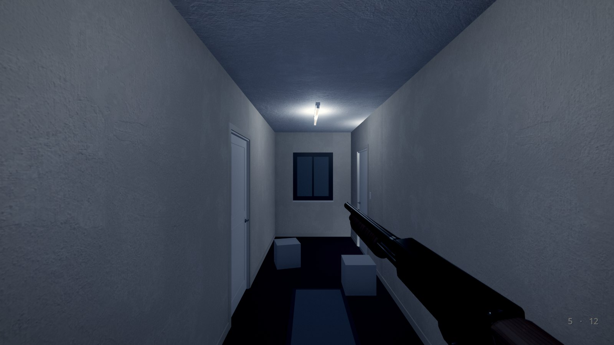
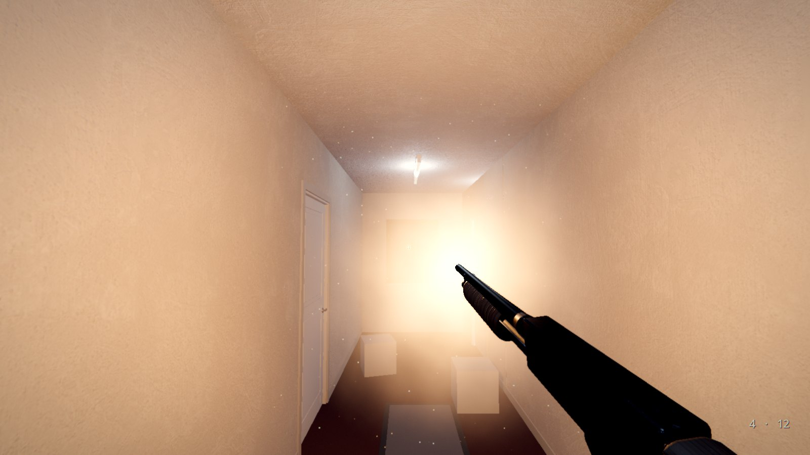
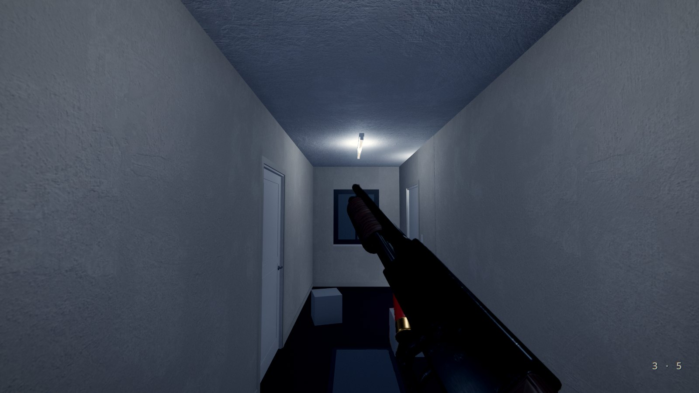

# HorrorStudio Weapons: a shotgun in first person for any Godot 4.7 game

One add-on (`addons/horrorstudio_weapons/`, GDScript with its models and sounds, nothing to build): **HSShotgun**, a
pump-action 12-gauge held in first person, and **HSWeaponPickup**, the gun or a box of shells lying in a room. Made for
horror first: one heavy, slow gun, four in the tube and one in the chamber, every shell counted and loaded by hand, and
no hands on it (the user's, DECISIONS 2026-11-09). A game made by hand gets it with `tools/godot_byhand.py`.

 
 

| Piece | File | Use |
|---|---|---|
| **The shotgun** | `shotgun.gd` (`HSShotgun`, a Node3D) | put one under the player's camera. Held low on the right, its barrel's line meeting the middle of the view `aim_at_m` ahead (as the user's reference); it sways behind the view as it turns, bobs as you walk, breathes, kicks, and never pokes through a wall. `pull()`, `rack()`, `reload()`, `set_raised(up)`, `give(shells)`, `add_shells(n)`; `loaded`, `chambered`, `spare`, `capacity` |
| **Pickups** | `pickup.gd` (`HSWeaponPickup`, a Node3D) | `kind` shotgun (the gun lying on its side, `shells` coming with it) or shells (a box of them); E takes it (the starter's player uses anything with `use()`), `say` a line through the Story, `taken` to wire a scare to |
| **The models** | `models/` | the prop generator's `shotgun_pump` (its pump a part that slides, the bolt's face a part there only while the action is shut, the trigger on its hinge; sockets `muzzle`, `eject`, `port`, `chamber`, `pump`, `grip`, `trigger`, `shoulder`, `light`), `shell_12ga` and `shell_12ga_spent` (`tools/propgen.py make <name>`, docs/PROPGEN.md §30; `shotgun_pump_black` the synthetic stock to swap in) |
| **The sounds** | `sounds/` | made in code (`tools/weapon_sounds.py`: numpy, then ffmpeg to Ogg): the blast with its tail, the pump back and forward, a shell clicking in, the dry click, a hull on the floor, the handling |

## By hand

1. `python tools/godot_byhand.py new ~/Games/MyGame` (or `install` into a project you have: the plugin's copied in and
   enabled).
2. Under the player's camera (the starter's `Player/Eye`) add a Node3D and give it `shotgun.gd` (or add an **HSShotgun**).
   Set its **light** to the flashlight (`Player/Eye/Flashlight`): it's carried under the barrel while the gun is up, its
   beam along the bore, and back on the eye when it's lowered.
3. Found, not carried: untick **owned** and put an **HSWeaponPickup** (kind shotgun) where it lies. Boxes of shells:
   HSWeaponPickup, kind shells, `shells` 5.
4. Play: **left click** fires (the pump racked by itself after), **R** reloads a shell at a time (a click stops it and
   fires as soon as it can), **Q** lowers and raises it, **E** takes a pickup.
5. Hear it from your scripts: `fired(hits)`, `racked(spent)`, `shell_in(loaded)`, `empty`, `raised_changed(up)`. A thing
   shot (or a node above it) with a `shot(info)` method is told: `{point, normal, dir, from, pellet}` once a pellet. Every
   node in the group `hs_listener` hears a shot `noise` loud (the starter's `searcher.gd` comes for it); the Fear node's
   ears ring; the Sound node plays it through the rooms.

## The numbers

- **The shot**: nine pellets of 00 buckshot in a cone of `spread_deg` 2.6° (23 cm across at 5 m), `reach_m` 45, each
  pushing a thing that moves 0.9 N·s; a hole each (a Decal, the last 180 kept), dust off the wall; the flash a frame or
  two (`flash_energy` 5) with smoke that scatters the light that reaches it and never darkens the room; the view kicked
  3.2°.
- **The pump**: 0.17 s after the shot, back 0.16 s (the bolt's face gone, the hull thrown out of the ejection port to
  the right, onto the floor), 0.05 s, forward 0.14 s: a shot every 0.53 s at most, under two a second (the flash
  limit is three).
- **The reload**: the gun turned 0.28 s to bare its loading port; each shell from under the gun, its nose raised into
  the port, levelled on the tube's line and pushed in until its rim's past the latch (`insert_secs` 0.34, then
  `insert_gap` 0.12: about 0.47 s a shell); back 0.24 s; racked if the chamber's empty.
- **The hulls**: thrown in view for 0.22 s, then into the room, falling, bouncing and rolling on their side by rays of
  their own (a body this small sinks through a level's thin floor in a physics engine's slop); the last 16 kept.

## Notes

- A view model: every material's z clip scale (0.35) keeps the gun in front of the wall you stand against while the
  room still lights it; it casts no shadow. `fov` gives it a lens of its own (0: the camera's).
- The gun is drawn by the hold's numbers (`hold`, `aim_at_m`, `cant_deg`), not posed by hand: change those to hold it
  higher or lower.
- No crosshair of its own: the HUD's reticle (HorrorStudio UI) is the middle of the cone. The shells left show low on the
  right a moment after each change (`hud`).
- `tools/godot/weapons_check.py` (WEAPONS) builds it into the hotel corridor of tutorial v2 and plays it headless;
  `--pictures` draws `img/`.
