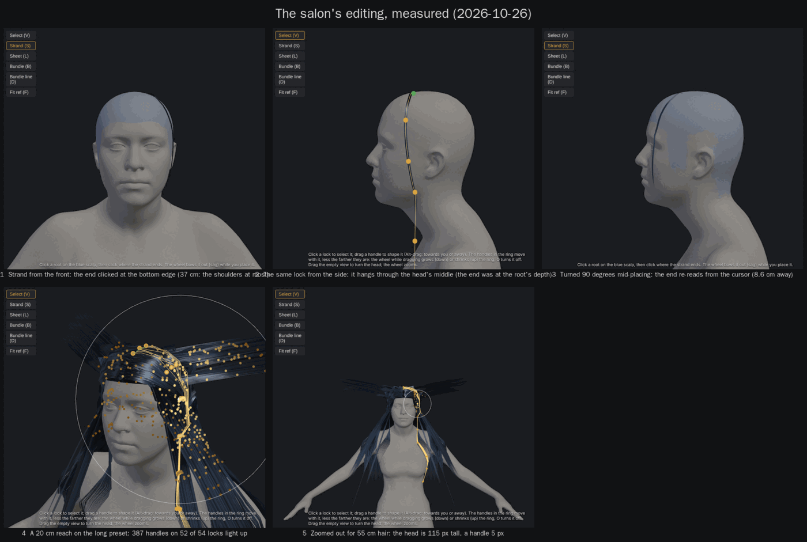

# Making hair in the salon: what's hard, and what would make it easier (2026-10-26)

A review of the salon's editing (`tools/character/salon.js`, `salonlib.js`), asked for on the branch
`easier-hair-editing`: every place where making hair by hand is slower or less sure than it should be, measured
where it could be, with an enhancement proposed for each and a size (**S** a commit, an hour or two; **M** a few
commits, a session; **L** more). The user's three asks are **1**, **7** and **11**, worked out in full. Nothing here
is built yet: say which numbers to build (a suggested order is at the end).

Not reviewed: the look, the bake, the reference's fit and the presets (not the ask). SALON_PLAN.md's unbuilt phases
(tracing the outline, the galleries, the brushes) are named where they'd answer a point.

## How it was measured

`node tools/character/salon_audit.js [out dir]` with the Character Studio's server running: it opens the salon on the
base body in a headless browser (the view 760 x 700 px beside the panel), places locks with the mouse as a user would,
loads the long preset, and writes `audit.json` and five screenshots (`Saved/SalonAudit/` by default).
`docs/assets/salon/editing_pain_points.png` is the sheet of them. Run it again after a change to see what moved.

| Measured | Result |
|---|---|
| The default view (0.85 m, a 30° lens): the head's height on screen; how far below the chin the cursor can reach | 347 px; 13.5 cm |
| A strand from the crown to the bottom edge of that view | 37 cm (to the shoulders), 6 handles |
| The view zoomed out for 55 cm hair (2.5 m): the head's height; a handle's width; a pixel | 115 px; 5 px; 2 mm |
| The same strand placed from the front, seen from the side | hangs through the head's middle (the end at the root's depth) |
| The view turned 90° while placing, the cursor back on the same spot | the end lands 8.6 cm from where it was |
| A sheet's root line dragged from the crown down past the ear onto the cheek | stops at the scalp's edge without saying: 10 points, 8 cm |
| The long preset (*Long, straight, middle parting*): locks, handles, groups | 54 sheets, 1 788 handles, 4 groups; 54 rows in Locks (1 810 px) |
| A pull from a crown handle: the handles (locks) it takes at a reach of 8, 20 and 50 cm | 69 (17); 387 (52 of 54); 1 235 (54) |
| From the front, a click on a lock 18 cm behind the head | picks it, through the head |

## A. Placing a lock

**1. The end is a click on a plane, not a vector you shape (the user's ask).** *Now* (`previewFrom`, the pointer
handlers; `salonlib.js` `drape`): a strand or a bundle is a click on the scalp for the root and a click for the end; a
sheet or a bundle line is the root line dragged along the scalp, let go, and a click for the end. The end is where the
cursor's ray meets the plane through the root facing the view (or the body, if the body there is within 10 cm of the
root's depth). The curve is six control points straight from root to end, laid onto the head and smoothed; the wheel's
sag bows it (a strand only: 3). The preview follows the cursor; the click commits, and from then on only the handles
move (5 a strand, 15 a sheet), each in the view plane. *Why it's hard:* "drag the mouse down" is the natural stroke,
but the stroke the tools know is the root line, not the hair; the end is the root's depth, so from the front a lock
from the crown hangs through the head's middle and from the side it lies flat in the head's side plane (pictures 1
and 2 on the sheet); the direction a lock leaves the head and where it ends are one click, with no moment to look before
it's in; turning to look re-reads the end from the cursor (8.6 cm away after a quarter turn, picture 3); and the lowest
reachable point in the default view is 13.5 cm below the chin, so a lock can be 37 cm at most before zooming out (2).
*Proposed:* **the placing arrow.**
1. After the root (or the root line), the lock appears at once at a starting length (the last lock's; 15 cm the first
   time), hanging down and out the way gravity would, with **one arrow** from the root's middle to its end: the lock's
   vector. Drag the arrowhead to set the length and the way it goes; the hint reads "22 cm, 35° off the head"; the
   wheel bows it (sag) for every type, Shift+wheel sets the type's own number (a sheet's spread, a bundle's root
   width, a bundle line's height). The preview is the lock as it will be (it already is).
2. The end is a point in space, kept while you look round: right-drag turns the view, the arrow stays where it is, and
   you drag it again from the side (or in the side pane, 7): the drag moves it in the plane facing the current view,
   Alt for depth, as a handle drag does.
3. **OK** (a button beside the arrow, or Enter) commits; Esc cancels; a click on the scalp commits the lock in hand and
   starts the next. The fast path stays: root, end, Enter.
4. After placing: a **Length** slider in Selected (the lock resampled along its own curve to the new length, the root
   fixed, grown along its last direction) and a **Sag** slider (the bow, today only the wheel while placing), so a lock
   made short is made long without zooming out and a row of locks is set to one length.

In the code: `PLACE.end` set on the first end click, moved by an `end` drag (as the handle drag), kept across turns;
`previewFrom` builds from it, not the cursor; `commitPlace()` on OK, Enter or the next root; the arrow a
`THREE.ArrowHelper` in HANDLES; `sag` honoured by every maker; `setLength(lock, L)` in salonlib. SALON gains a lock
placed, its arrow dragged from the front and the side, Enter, Esc, Length on a sheet. **M.**
**Built 2026-10-26**: the lock stays in hand after its end click (the fast path keeps its two clicks) with the arrow and OK; the arrowhead's drag turns and scales the lock about its root keeping the hand shaping (`setVector`); Enter or OK lets go; Length and Sag sliders; SALON drags the arrow from the front (the end under the cursor within 1 mm) and from the side (3.7 cm in depth, 2 mm sideways).

**2. Long hair means zooming out until the head is tiny.** *Now:* the end has to be on screen; the default view reaches
13.5 cm below the chin (a 37 cm lock); chest length wants 1.6 m (the head 181 px, a handle 7 px), the waist 2.5 m
(115 px, 5 px, 2 mm a pixel). *Proposed:* 1's Length slider and starting length do most of it; also **the view pans
while a drag passes its edge** (dragging an end or a handle past the bottom scrolls the view down, as a desktop drag
does), and **three zoom stops** on the toolbar (the head, the bust, the whole torso: Home cycles them). **S.**

**3. A sheet or a bundle can't be bowed while placing.** *Now:* the wheel changes the sag for a strand only; for a
sheet it's the spread, for a bundle the root's width, for a bundle line the height, and the sag stays 0 (`makeSheet`
gets `sag * 0.7` of a number that's never set). *Proposed:* the wheel bows every type, Shift+wheel the type's own
number (as in 1). **S.**
**Built 2026-10-26**: the wheel bows every type, Shift+wheel the type's number; SALON places a sheet bowed by the wheel.

**4. The root line stops at the scalp's edge without saying, and a click gives a 3 cm line.** *Now:* points are added
only while the cursor is over the scalp (every 8 mm); dragged over the ear or past the hairline, the line keeps what it
had (measured: the crown to the cheek gave 8 cm, stopping at the sideburn); a click without a drag makes a 3 cm line
across the view. *Proposed:* a dot under the cursor, green on the scalp and red off it; the hint reads the line's
length while it's drawn; the root line editable after placing (5). **S.**
**Built 2026-10-26**: the dot (green on the scalp, red off it), the root line's length in the hint, the line's handles (5).

**5. Roots can't be moved: a misplaced root is delete and redo.** *Now:* `handles()` marks the first point a root,
the pull leaves roots where they are, and a sheet's root line has no handles at all; Duplicate offsets a copy by 1 cm
and that's the only move there is. *Proposed:* the root handle (green) dragged **slides the root along the scalp**
(`COL.surface`), the whole lock going with it and laid onto the head again; a sheet's root line dragged by its middle
slides it, by an end stretches it. **S** (a strand or a bundle), **M** (a sheet's line).
**Built 2026-10-26**: the root handle dragged slides the lock (`slideRoot`); a sheet's root line by its middle or an end; SALON slides a strand 2.1 cm and a root line, stretches its end alone.

**6. Every lock leaves the head the same way.** *Now:* Roots (lift, bend, vary) is one setting for all the hair.
*Proposed:* a per-lock **Lift** in Selected overriding it (a fringe lifted, the back flat). **S.** The way a lock is
combed from its root (a second, short arrow at the root) is the brushes of SALON_PLAN Phase 2 (comb); later.

## B. Seeing what you do

**7. No side view beside the front view (the user's ask).** *Now:* one view, a free orbit or the reference's frame;
to check a lock's depth you turn, look and turn back; a handle drag moves in the view plane, so depth takes Alt, blind;
the Character Studio already has **Split** (`index.html`: `SPLIT`, `panes`, `paneAt`, `viewRect`: two panes, each its
own orbit, the pane under the pointer takes the wheel and the view buttons, the line between them dragged) and the
salon doesn't. *Proposed:* **Split** in the salon as in the Studio: the view in two panes, left the working view and
right a side view (each pane its own orbit; the view buttons of 8 act on the pane the pointer last touched); every tool
works in either pane (the placing arrow, handles, the pull's ring, the root line, picking), by that pane's camera and
rectangle; the reference's frame only in a pane locked to it; the line between them dragged, a double-click evens it,
Split again for one view. With 1: drag the arrow in the front pane for the length, in the side pane for how far it
stands off the face. In the code: `render()` draws each pane with its camera (`setScissor`/`setViewport`); `rayAt`,
`screenOf`, `onPlane`, `handleAt`, `lockAt` take the pane under the pointer; `orbit` becomes the active pane's; the
overlay per pane. SALON gains a handle dragged in the right pane moving in depth as seen from the left. **M.**
**Built 2026-10-26**: Split in the view bar (the header): two panes with their own orbits, scissor-rendered, every tool in the pane under the pointer; the divider dragged and evened; SALON places a strand in the left pane and drags its handle in the right (2.4 cm in depth, 0 mm sideways).

**8. No view buttons, no top view, no orthographic view.** *Now:* the view is turned by hand only (the reference
panel's Front, when a reference is loaded, is the one button); the pitch is clamped to ±69°, so the crown is never seen
from straight above (a parting, the cover's Y's); a 30° perspective lens, so hair on the far side leans. *Proposed:*
**Front, ¾, Side (left and right), Back, Top** on the toolbar with Blender's keys (1, 3, 7; Ctrl for the opposite),
the pitch to ±90°, an **orthographic** toggle (5) for lining things up. **S.**
**Built 2026-10-26**: the view bar (Front, ¾, Side L and R, Back, Top, Ortho) with the keys; the pitch to 89°; ortho picks and pans as perspective does (SALON: two depths 17 px apart in perspective on one column in ortho, a pick 0 px off).

**9. The lock you're on doesn't stand out, and handles don't read in depth.** *Now:* handles are 4.5 mm gold spheres
drawn over everything (no depth test), so a handle behind the head looks like one in front; the selected lock is only
told by its handles; the other locks are all one colour (Colour by lock is a Look option). *Proposed:* the selected
lock drawn brighter with its outline, the rest dimmed while Select is on, an **Isolate** switch (X-ray: only the
selected lock, its twin and its group drawn solid, the rest ghosted); handles behind the head drawn hollow. **S.**

**10. Picking goes through the head.** *Now:* `lockAt` picks the nearest lock point within 9 px on screen, whatever
its depth (measured: a lock 18 cm behind the head picked from the front). *Proposed:* skip points the head hides
(the head hit's depth against the point's), prefer the nearest in depth among those in reach, and **click again to
cycle** through the locks under the cursor. **S.**
**Built 2026-10-26**: `lockAt` takes the nearest in depth, skips what the head hides, and cycles on a click again (SALON: a strand behind the head not picked from the front; two in front picked in turn).

## C. Shaping

**11. The pull reaches everything (the user's ask).** *Now* (`pullOpts`, `shownIds`, `drawReach`): a pulled handle
takes every handle shown within the reach, on its own lock and all the rest; the limits are **This lock only** (one
lock) or hiding groups; a twin's handles pull their original's mirrored, and an original near the seam takes both
pulls. Measured on the long preset: from a crown handle, 8 cm takes 69 handles on 17 locks, 20 cm 387 on 52 of 54,
50 cm all 54. *Proposed:*
1. **Pull scope** in the Pull step, with keys: *This lock* / *This lock and its twin* / *This group* / *All shown*;
   the default *This lock and its twin*, the scope in the hint; the ring lights only what the scope takes, so you see
   it before pulling (`drawReach` uses the same ids).
2. **Locked locks and groups**: a padlock on every row in Locks and a Lock button in Selected (L). A locked lock, or
   every lock of a locked group, never moves under a pull, under Gravity (it stays as a layer the rest falls onto:
   `startDrop(only)` already does this for the cover), under All onto the scalp or the cover's making; it is still
   drawn, picked and laid over. A twin's state follows its original. `locked` saved per lock and group in
   `salon.json`, kept by Save as a hairstyle.
3. With 15: *Selected locks* as a scope when several are picked.

In the code: `PULL.scope`; `pullIds()` in place of `shownIds()` in `pullOpts` and `drawReach`; `lock.locked`,
`group.locked`; `startDrop()` passes the unlocked ids as `only` when any is locked. SALON gains a 50 cm reach on the
long preset moving one lock and its twin, and a locked group unmoved by a pull and by a drop. **S** (the scope and the locks).
**Built 2026-10-26**: Scope in Pull (the default *This lock and its twin*), the padlocks in Locks and Lock in Selected; SALON measures a 50 cm pull on the long preset moving 1 lock, 1 with its twin, 3 of 6 in its group, 31 of 54 in all, and a locked group unmoved by a pull and by Gravity.

**12. Moving or swinging a whole lock is handle by handle.** *Now:* a sheet has 15 handles; moving it sideways, or
swinging it about its root, means dragging each; `moveLock` exists but only Duplicate uses it. *Proposed:* with Select
on, **drag the lock's body** (not a handle) to swing it about its root (the root stays, every point turns with the
drag; Shift to slide it along the scalp with its root: 5); **G** and **R** as Blender's. **M.** The brushes (comb,
grow, puff, smooth: SALON_PLAN Phase 2) are the next step after it.

**13. Shaping is in the view plane; depth takes Alt.** Answered by 7 (drag in the other pane) and 9 (hollow handles
behind). No work of its own.

## D. Keeping track

**14. The Locks list.** *Now:* one row a lock (54 for the long preset, 1 810 px), named by where it grew ("back -28°
165°"), no pictures; a group can be made and shown or hidden but not renamed or deleted; a lock's group is the group
that was active when it was placed, with no way to move it; nothing says a lock's length. *Proposed:* a **Group**
picker in Selected (and Move to group on the right-click), rename and delete on a group's row, groups folded, **Solo**
on a group's eye (Alt-click: only it shown), each row with its length and type, the selected row scrolled into view.
**S.**
**Built 2026-10-26**: the Group picker, rename (double-click), delete (✕), Solo (Alt-click), fold, counts, lengths on the rows, the selected row in view.

**15. One lock at a time.** *Now:* one selected lock; Delete, Mirror once, Onto the scalp, Physics and the own colour
work on it alone. *Proposed:* **several picked** (Ctrl-click, Shift-drag a box, a group's row to pick all of it):
the Selected step's buttons act on all, the pull's scope *Selected locks* (11.3), Delete on all. **M.**

## E. Falling

**16. Gravity drops everything shown.** *Now:* the switch drops all the hair shown (`startDrop()`); only the cover's
making drops some locks onto the rest (`startDrop(only)`); to let one new lock fall onto finished hair there is no
way (hidden hair isn't landed on). *Proposed:* **Let it fall** in Selected (this lock, or the group: the rest stays
as the layer it lands on, as the cover does), and the locked ones of 11 left out of the big switch. **S.**
**Built 2026-10-26**: Let it fall and Let the group fall in Selected (the Gravity step opens); SALON drops one of two strands.

## F. The small things

**17. The hint and the keys.** *Now:* the wheel's number shows only after the first notch; Enter does nothing
(nothing finishes or confirms); no key for the views; Backspace deletes the selected lock's original and all its
twins (right with Mirror, surprising without it). *Proposed:* the hint per stage ("root placed: drag the arrow, wheel:
sag, Enter: OK"), the wheel's current value in it from the start, Enter and Esc everywhere a stage has an end, the
view keys of 8. **S.**
**Built 2026-10-26**: the hint per stage (with 1), Enter and Esc, the wheel's value from the start, the view keys (with 8).

**18. A new lock starts from the defaults, not from the last one.** *Now:* every strand is 6 mm wide, taper 0.6,
cards; the wheel's spread, width and height carry over between locks but the sag and the Selected settings don't.
*Proposed:* a new lock takes the last lock's width, taper, drawn as, thickness, physics and colour (**Like the last
lock**, on by default). **S.**
**Built 2026-10-26**: the tick in Locks; SALON places a strand with the last one's width and taper, and one with the defaults.

**19. No draft kept.** *Now:* leaving with unsaved hair asks; nothing is kept in the browser (only which steps are
open); the desk keeps every unsaved edit in localStorage and offers it back. *Proposed:* the same here (a draft a
second after each edit, offered on opening the character, merged with what the disk has). **S.**
**Built 2026-10-26**: the draft under the hair's name a second after each edit, offered back on the status line, Undo takes it away (no merge: the draft replaces, as the salon has no second editor).

## A suggested order

1. **11** the pull's scope and locked locks (S: the user's ask, the smallest).
2. **1** and **3** the placing arrow with sag for every type, Length and Sag sliders (M: the user's ask).
3. **8** the view buttons, the top view, orthographic (S).
4. **7** Split, the side pane (M: the user's ask; 8 first so each pane has its buttons).
5. **5** roots that slide, **10** picking that respects the head, **4** the root line's dot (S each).
6. **16** Let it fall, **14** the Locks list, **17**, **18**, **19** (S each).
7. **12** swinging a whole lock, **15** several picked, **2** the view that pans (M).

Each step is its own commit with SALON grown for it, as SALON_PLAN's rules say.
